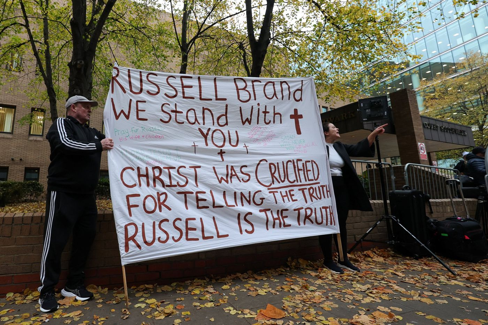

*By Kyekyeku*

Before Russell Brand was sentenced at London's Southwark Crown Court, the court heard from the four women whose testimony helped convict him. In their impact statements, they described how the crimes had affected their lives for years. One woman said Brand's fame and influence had left her feeling powerless and afraid she would be disbelieved if she reported him.

On 9 November, the British comedian and former broadcaster was sentenced to 10 years and six months in prison. A jury had found him guilty of one count of rape and three counts of sexual assault against four women between 2004 and 2009. Brand denied the charges. He was acquitted of two other counts of rape and one count of attempted indecent assault.

### What Grace Asks of the Church

Brand began speaking publicly about his Christian faith after allegations against him were published in 2023. He was baptised in 2024 with the help of television adventurer Bear Grylls. At sentencing, Brand's lawyer argued that he had changed in the years since the offences.

For Bekah Legg, chief executive of Restored, a Christian organisation working to end violence against women, the case raises a question for churches about how they speak of grace when someone has caused serious harm.

"There's grace and there's consequences," Legg told Premier Christian News. She said churches can confuse the two and lose sight of accountability when someone professes faith or appears to be changing. A Christian response, she argued, begins by taking seriously what survivors endured and what it cost them to give evidence.

Legg urged Christians to pray that the women would feel heard and supported in their recovery. She also spoke of what prayer for Brand could mean in practice. She said she hoped he would encounter God in prison, acknowledge his actions, apologise and look for ways to make amends. For some survivors, she said, hearing an offender take responsibility can matter, even when the harm cannot be undone.

### When Influence Makes It Harder to Speak

Christian media lawyer Jonathan Coad told Premier Christian News that he doubted the conviction alone would change the culture of the entertainment industry. He pointed to the power gap between prominent performers and production staff, who may fear for their careers or wonder whether anyone would believe them if they spoke up.

That question reaches beyond broadcasting. It matters in churches and ministries too, especially when a person accused of abuse is someone others admire or depend on. A congregation's response can be seen in what happens when someone comes forward. Who listens? Who helps them get support? Who makes sure the concern is taken seriously, even when the person accused holds influence?

For the four women at the centre of this case, the sentence came years after the offences. As Christians pray for their healing, churches can also look at how they receive people who disclose abuse and what they do to protect them in the days that follow.
