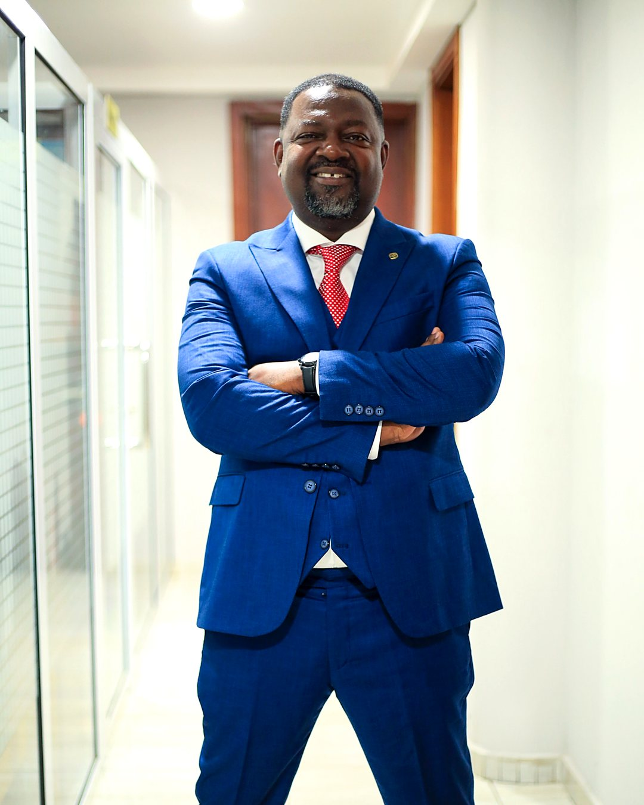

Starcom Group, owners of Sunny 88.7 FM, Spirit 88.3 FM and Shaft FM, has launched **Christian Connect Church & Business (CCC&B)**. It's an online directory on the Sunny FM and Spirit FM websites that brings churches, ministries and Christian-owned businesses together on one trusted platform.

*Kojo Oppong Adjei, Operations Director of Starcom Group (Sunny FM, Spirit FM and Shaft FM)*

CCC&B is now live on sunnygh.com and spiritgh.com. Churches can list their services, locations and ministries there, and Christian entrepreneurs, from caterers and tailors to builders, pharmacists, transport operators and tech firms, can present their products and services to a large and growing community of believers across Ghana.

Speaking at the launch, **Kojo Oppong Adjei, Operations Director of Starcom Group**, said the platform grew out of a simple conviction: believers should be deliberate about supporting one another in the marketplace.

"The Bible is clear on this," he said. "Galatians 6:10 says, *'So then, as we have opportunity, let us do good to all people, and especially to those who belong to the family of believers.'* Every time a Christian chooses to buy from a fellow believer, that is an opportunity to do good. It keeps money working within the household of faith, it creates jobs for our brothers and sisters, and it strengthens the churches those businesses support."

He stressed that CCC&B is not about shutting anyone out. "The verse begins with *all people*. We serve everybody, and every listener is welcome to use this directory. But Scripture also asks us to give special attention to the family of believers. Many of our listeners are running small businesses with faith and integrity, and they simply need visibility. This is our way of opening the door for them."

According to Mr. Oppong Adjei, CCC&B also responds to a question the stations hear often from listeners: *"Where can I find a Christian I can trust for this job?"* Whether someone is looking for a reliable mechanic, a wedding planner, a school, or a church to attend after relocating, the directory puts those answers in one place.

"Trust is everything in business," he said. "When you know the person you're dealing with shares your values, honesty and accountability come easier. We want CCC&B to become the first place a Christian checks before they spend."

## How to get listed

Churches, ministries and Christian-owned businesses can submit their own listings directly on sunnygh.com or spiritgh.com by filling in their details, contact information, location and a short description of what they offer. Listings appear on both station websites, so every business reaches audiences in Accra, Kumasi and beyond.

Listed businesses will also have the opportunity to be featured on air across Sunny 88.7 FM and Spirit 88.3 FM through special promotions, interviews and spotlight segments.

## Building a stronger family of faith

Mr. Oppong Adjei said CCC&B reflects Starcom Group's wider commitment to using media for the good of the Church and the nation.

"Our stations exist to encourage, inform and build up believers," he said. "Helping the body of Christ prosper together is part of that calling. If one business grows, the employees grow, the families grow, and the church grows. That is how we do good, as Paul said, while we have the opportunity."

Churches and businesses are encouraged to list today and to share the directory with their congregations and networks.

*To list your church or business, visit sunnygh.com or spiritgh.com, or call Sunny FM on 054 522 3324.*
